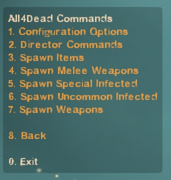
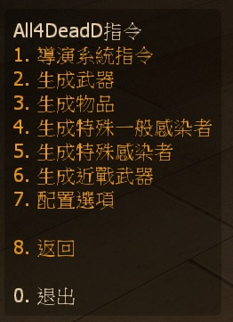

# Description | 內容
Enables admins to have control over the AI Director and spawn all weapons, melee, items, special infected, and Uncommon Infected without using sv_cheats 1

* Apply to | 適用於
    ```
    L4D1
    L4D2
    ```

* Image
    <br/>

* <details><summary>How does it work?</summary>

    * Admins type ```!admin``` to call adm menu and you will see "ALL4DEAD" option
    * It can spawn any items, weapons, infecteds.. in your crosshair location
    * Support custom melee
</details>

* Require | 必要安裝
    1. [left4dhooks](https://forums.alliedmods.net/showthread.php?t=321696)
    2. [[INC] Multi Colors](https://github.com/fbef0102/L4D1_2-Plugins/releases/tag/Multi-Colors)
    3. [spawn_infected_nolimit](/spawn_infected_nolimit)

* Directory Structure | 檔案結構
    ```php
    /
    ├── plugins/
    │   └── all4dead2.smx            # Compiled plugin | 已編譯的插件
    ├── scripting/
    │   └── all4dead2.sp             # Source code | 源碼
    └── translations/
        └── all4dead2.phrases.txt    # Multi-language translation | 翻譯多國語言
    ```

* <details><summary>ConVar | 指令</summary>

    * cfg/sourcemod/all4dead2.cfg
        ```php
        // If 1, Announce changes to all players in game
        a4d_notify_players "1"
        ```
</details>

* <details><summary>Command | 命令</summary>

    * **Spawn Special Infected (Adm required: ADMFLAG_ROOT)**
        ```php
        a4d_spawn_infected <zombie|mob|witch|tank|boomer|hunter|smoker|spitter|jockey|charger>
        ```

    * **Spawn items and weapons, read more item and weapons [here](https://commands.gg/l4d2/give) (Adm required: ADMFLAG_ROOT)**
        ```php
        a4d_spawn_item <rifle|first_aid_kit|ammo....>
        a4d_spawn_weapon <rifle|first_aid_kit|ammo....>
        ``` 

    * **This command forces the AI director to start a panic event (Adm required: ADMFLAG_ROOT)**
        ```php
        a4d_force_panic
        ``` 

    * **This command forces the AI director to start a panic event endlessly (Adm required: ADMFLAG_ROOT)**
        ```php
        a4d_panic_forever
        ``` 

    * **Enable or disable notifications (Adm required: ADMFLAG_ROOT)**
        ```php
        a4d_enable_notifications <0|1>
        ``` 

    * (L4D2) **Spawn uncommon infected (Adm required: ADMFLAG_ROOT)**
        ```php
        a4d_spawn_uinfected <riot|ceda|clown|mud|roadcrew|jimmy>
        ```
</details>

* <details><summary>Changelog | 版本日誌</summary>

    * v4.2 (2026-11-25)
        * Support L4D1
        * In versus/scavenge, Tanks spawned by this plugin will be passed to real infected players.

    * v4.1 (2026-11-12)
        * Update translation

    * v4.0 (2026-7-12)
        * Use other way to spawn witch and bride witch since recent l4d2 update has restricted the maximum number of witch spawns
        
    * v3.9 (2024-3-30)
        * Update cvars
        * Update cmds
        * Update Translation

    * v3.8 (2024-3-15)
        * Require spawn_infected_nolimit
        * Delete gamedata

    * v3.7 (2024-1-20)
        * Custom melee spawn support

    * v3.6 (2023-3-11)
        * Fixed translation phrase.

    * v3.5 (2023-1-27)
        * Translation Support. Thanks to wyxls.

    * v3.4
        * [AlliedModder Post](https://forums.alliedmods.net/showpost.php?p=2719391&postcount=503)
        * Convert All codes to new syntax.
        * Add gamedata to support infected spawn (without being limit by director)
        * Add All weapons、melee、items
        * Add firework crate
        * Add L4D2 "The Last Stand" two melee: pitchfork、shovel
        * Spawn Witch Bride Model in c6m1 to prevent crash
        * Add Gnome and Cola.
        * Display menu forever

    * v2.0
        * [Original Plugin by grandwazir](https://forums.alliedmods.net/showthread.php?t=84609)
</details>

- - - -
# 中文說明
管理員可以直接操控遊戲導演系統並生成武器、近戰武器、物品、醫療物品、特殊感染者以及特殊一般感染者等等，無須開啟作弊模式

* 圖示
    * 介面
    <br/>

* 原理
    * 管理員輸入```!admin```就能看到 "ALL4DEAD指令" 選項
    * 生成任意武器、近戰武器、物品、醫療物品、特殊感染者... 在準心眼前
    * 支援生成三方圖近戰武器

* 用意在哪?
    * 不需要開啟作弊模式就能輕鬆生成各種武器、物品與特感，適合用於服主做測試或惡搞

* <details><summary>指令中文介紹 (點我展開)</summary>

    * cfg/sourcemod/all4dead2.cfg
        ```php
        // 1=任何改變或生成會通知全體玩家, 0=不通知
        a4d_notify_players "1"
        ```
</details>

* <details><summary>命令中文介紹 (點我展開)</summary>

    * **生成特感 (權限: ADMFLAG_ROOT)**
        ```php
        a4d_spawn_infected <zombie|mob|witch|tank|boomer|hunter|smoker|spitter|jockey|charger>
        ```

    * **生成武器與物品，更多武器與物品代碼請看[這裡](https://commands.gg/l4d2/give) (權限: ADMFLAG_ROOT)**
        ```php
        a4d_spawn_item <rifle|first_aid_kit|ammo....>
        a4d_spawn_weapon <rifle|first_aid_kit|ammo....>
        ``` 

    * **強制AI導演開始屍潮事件 (權限: ADMFLAG_ROOT)**
        ```php
        a4d_force_panic
        ``` 

    * **強制AI導演開始無限屍潮事件 (權限: ADMFLAG_ROOT)**
        ```php
        a4d_panic_forever
        ``` 

    * **啟用或停用通知 (權限: ADMFLAG_ROOT)**
        ```php
        a4d_enable_notifications <0|1>
        ``` 

    * (L4D2) **生成特殊一般感染者 (權限: ADMFLAG_ROOT)**
        ```php
        a4d_spawn_uinfected <riot|ceda|clown|mud|roadcrew|jimmy>
        ```
</details>


