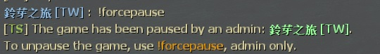
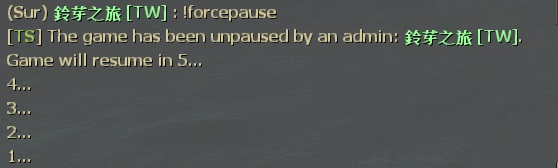

# Description | 內容
Allows admins to force the game to pause, only adm can unpause the game.

> __Note__ <br/>
This Plugin has been discontinued, Use 
<br/>[l4d_pause](https://github.com/fbef0102/Game-Private_Plugin/tree/main/L4D_%E6%8F%92%E4%BB%B6/Server_%E4%BC%BA%E6%9C%8D%E5%99%A8/l4d_pause)

* Apply to | 適用於
	```
	L4D1
	L4D2
	```

* Image | 圖示
	* Admin can type ```!forcepause``` to force-pause the game (管理員強制暫停遊戲)
	<br/>
	<br/>

* Require | 必要安裝
	1. [[INC] Multi Colors](https://github.com/fbef0102/L4D1_2-Plugins/releases/tag/Multi-Colors)

* <details><summary>Changelog | 版本日誌</summary>

	* Archived (2026-10-11)
		* This Plugin has been discontinued

	* v1.7 (2025-9-11)
		* Restore default chat behavior while paused
		* Credit: [A1mDev](https://github.com/SirPlease/L4D2-Competitive-Rework/commit/a31e639828aee1fa8f322a4816eab67c1dfdc0d3)

	* v1.6 (2024-8-16)
		* Support server console

	* v1.5 (2023-5-22)
		* The game would be unpaused if admin disconnects.

	* v1.4 (2023-3-14)
		* Optimize code

	* v1.3
		* Remake code
		* Only Adm can pause and unpause the gmae
		* Chat Color during pause
		* Fixed compatibility with plugin "smd_noTeamSay" v2.2+ by HarryPotter

	* v0.2.1
		* [Original plugin by pvtschlag](https://forums.alliedmods.net/showthread.php?t=110029)
</details>

- - - -
# 中文說明
管理員可以強制暫停遊戲，也只有管理員能解除暫停

> __Note__ <br/>
此插件已停止更新，請使用
<br/>[l4d_pause](https://github.com/fbef0102/Game-Private_Plugin/tree/main/L4D_%E6%8F%92%E4%BB%B6/Server_%E4%BC%BA%E6%9C%8D%E5%99%A8/l4d_pause)

* 原理
	* 管理員輸入 ```!forcepause``` 強制暫停遊戲
	* 管理員輸入 ```!forcepause``` 解除暫停
	* 當發動暫停的管理員離開伺服器時，遊戲會自動解除暫停


