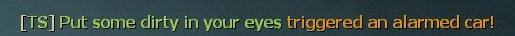
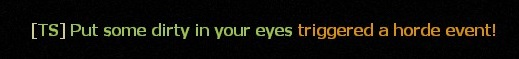
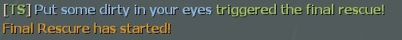

# Description | 內容
Who called the horde ?

* Apply to | 適用於
    ```
    L4D1
    L4D2
    ```

* Image | 圖示
	* Alarmed car (顯示誰觸發了警報車)
	<br/>
	* Horde event (顯示誰觸發了機關屍潮)
	<br/>
	* Final rescue (顯示誰啟動了最後救援)
	<br/>

* Require | 必要安裝
	1. [left4dhooks](https://forums.alliedmods.net/showthread.php?t=321696)
	2. [[INC] Multi Colors](https://github.com/fbef0102/L4D1_2-Plugins/releases/tag/Multi-Colors)

* Directory Structure | 檔案結構
    ```php
    /
    ├── gamedata/
    │   └── trigger_horde_notify.txt            # GameData | 遊戲數據
    ├── plugins/
    │	└── trigger_horde_notify.smx            # Compiled plugin | 已編譯的插件
    ├── scripting/
    │	└── trigger_horde_notify.sp             # Source code | 源碼
    └── translations/
        └── trigger_horde_notify.phrases.txt    # Multi-language translation | 翻譯多國語言
    ```

* <details><summary>ConVar | 指令</summary>

	* cfg/sourcemod/trigger_horde_notify.cfg
		```php
		// (L4D2) If 1, Notify who tirggers the alarm car.
		trigger_horde_notify_alarm_car "1"

		// Cold down time to notify again.
		trigger_horde_notify_cool_down_time "30.0"
		```
</details>

* <details><summary>Changelog | 版本日誌</summary>

	* v1.2 (2026-11-15)
		* Do not start cooldown when alarm car notify is disabled, thanks to Rainy

	* v1.1 (2023-6-20)
		* Require lef4dhooks v1.33 or above

	* v1.0
		* Intital Release
		* Thanks to [Forgetest](https://github.com/jensewe) for gamedata
</details>

- - - -
# 中文說明
顯示誰觸發了屍潮事件

* 原理
	* 顯示誰啟動了機關屍潮
	* 顯示誰觸發了警報車
	* 顯示誰啟動了最後救援

* 注意事項
	* 在二代裡非所有地圖機關會提示誰觸發，認真你就輸了

* <details><summary>指令中文介紹 (點我展開)</summary>

	* cfg/sourcemod/trigger_horde_notify.cfg
		```php
		// (L4D2) 為1時，顯示誰觸發了警報車提示
		trigger_horde_notify_alarm_car "1"

		// 再次提示的冷卻時間。
		trigger_horde_notify_cool_down_time "30.0"
		```
</details>
